# Tijori POS

**A complete point of sale and shop management system for independent retail stores.** Barcode till, inventory, purchases, customer credit (khata) ledgers, staff roles, reports and analytics, in one app that keeps selling when the internet drops.

Built with Django REST Framework, PostgreSQL and React + TypeScript. Runs in Docker or as a packaged Windows desktop app.

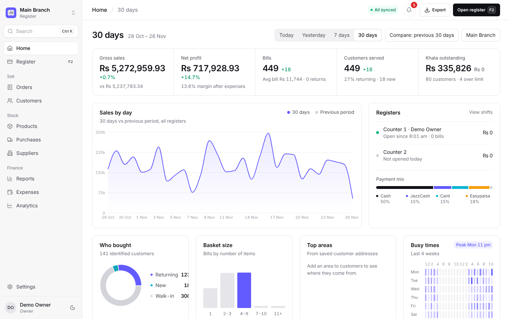

## Screenshots

All screenshots are from the running app with generated demo data (`seed_demo`).

| Till / register | Sign in |
|---|---|
| 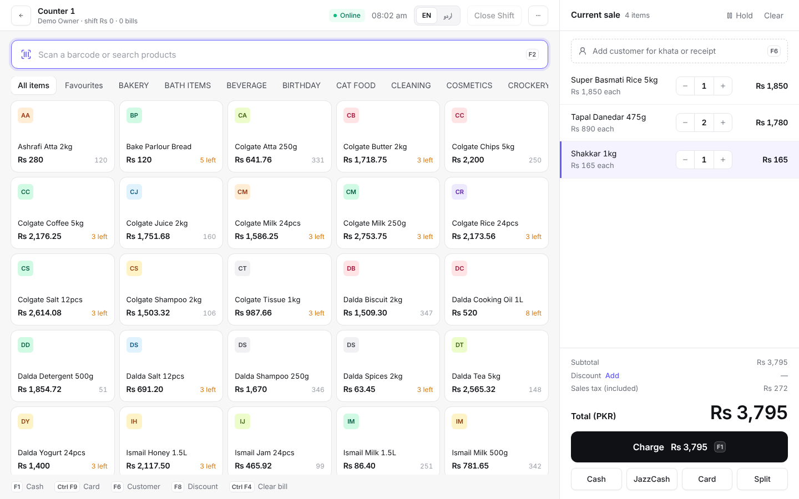 | 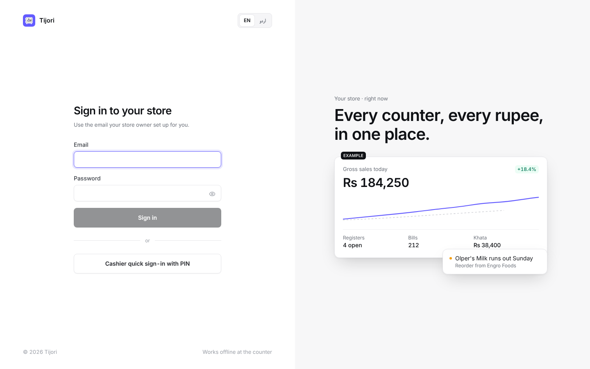 |
| **Products and stock** | **Orders** |
| 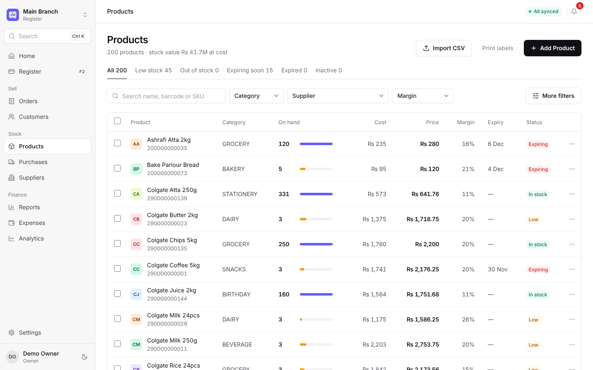 | 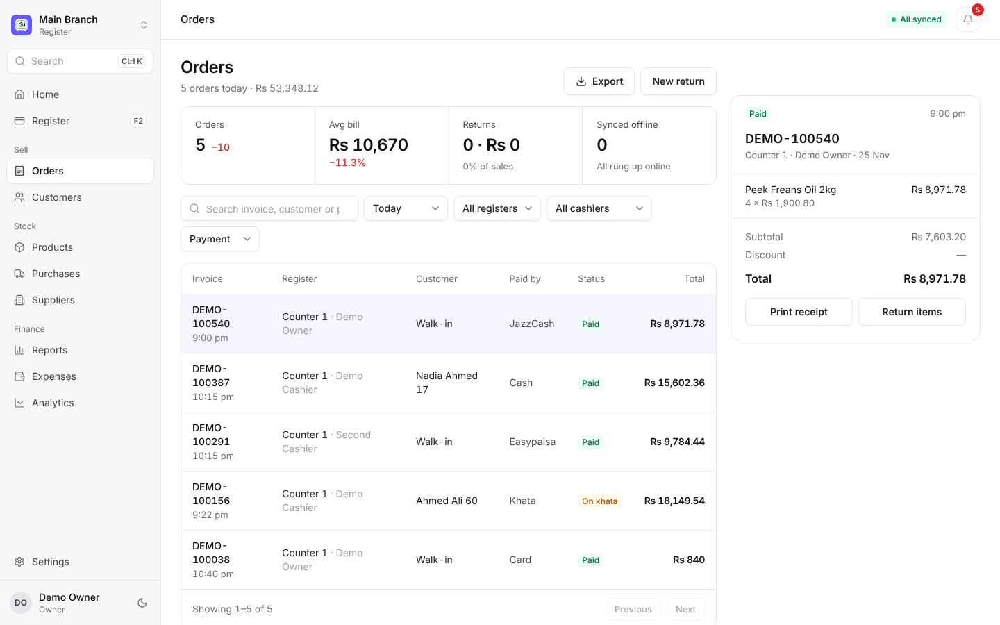 |
| **Customers and credit ledger** | **Suppliers and payables** |
| 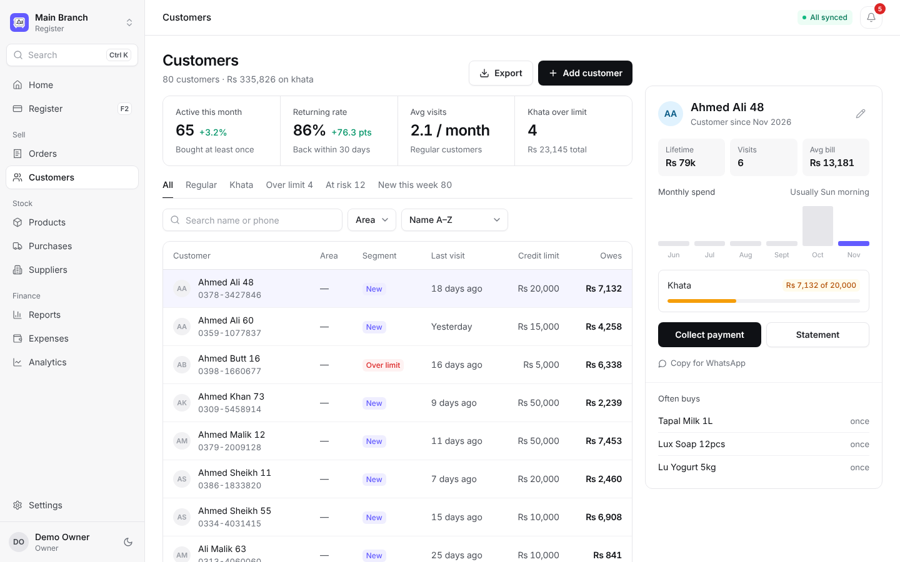 | 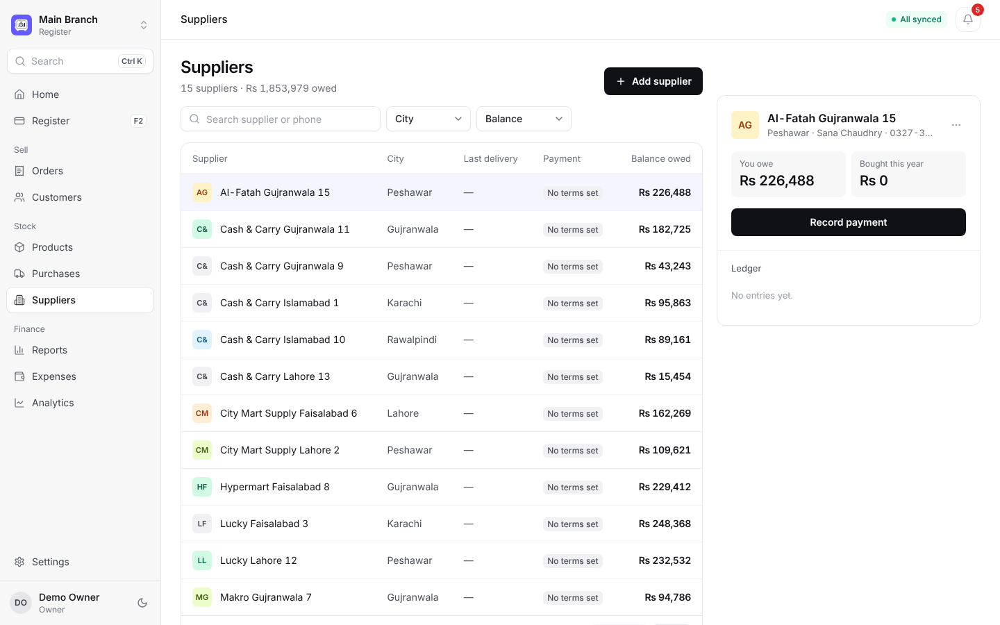 |
| **Profit and loss reports** | **Customer analytics** |
| 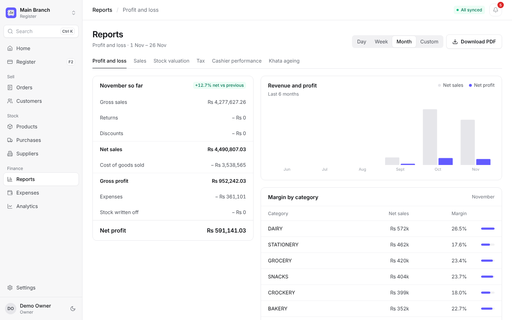 | 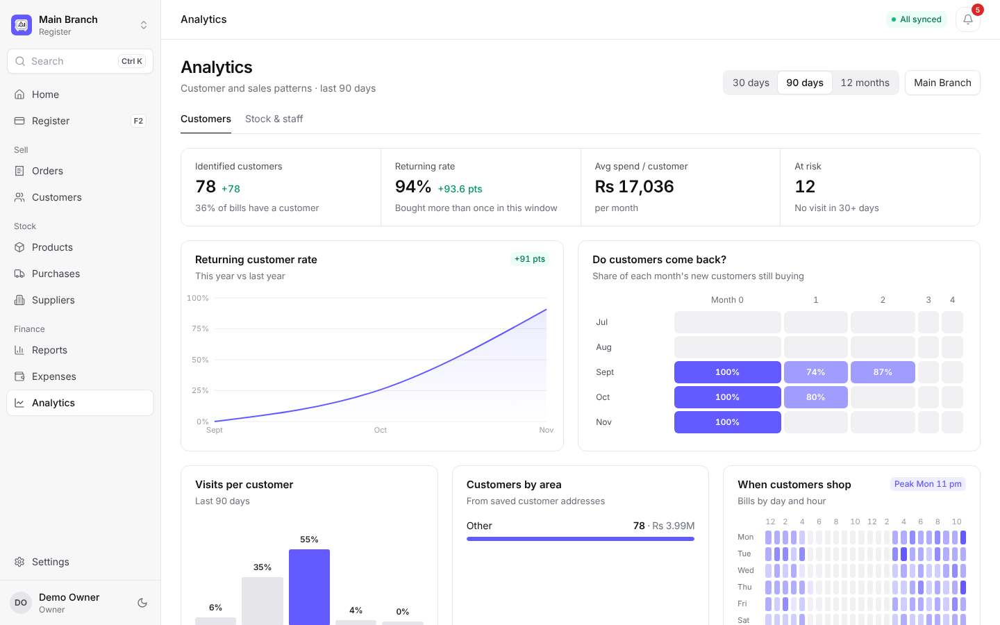 |
| **Expenses** | **Settings** |
| 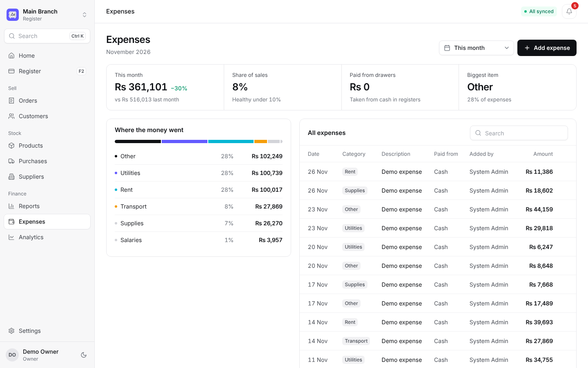 | 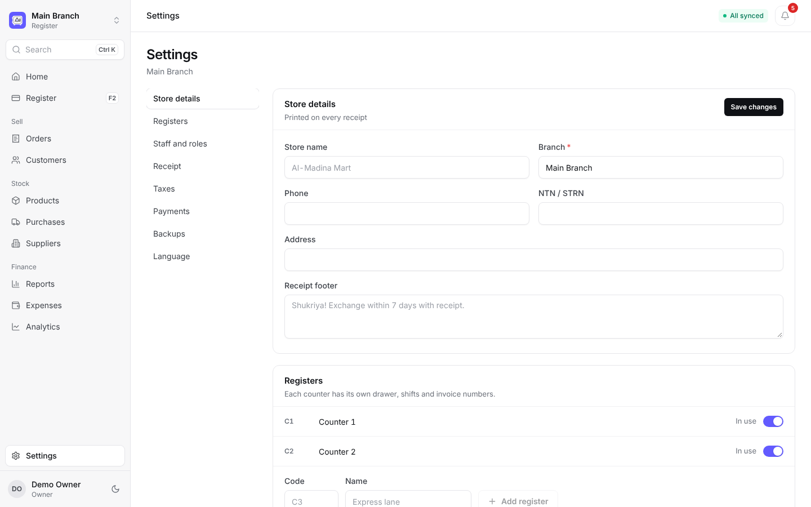 |

## Features

- **Fast till**: barcode scan or search, keyboard shortcuts (F1 charge, F2 scan, F6 customer, F8 discount), hold bills, split payments, receipts, cashier shifts with cash drawer counts
- **Works offline**: sales made while the server is unreachable are queued and synced later
- **Inventory**: products with extra barcodes, categories, batches, stock levels per branch, low-stock and expiry alerts, CSV import, label printing
- **Purchases**: goods received notes (post / void), supplier returns, cost change tracking
- **Sales**: full order history, invoice returns and walk-in returns
- **Customer credit (khata)**: credit limits, running balances, payments, statements
- **Suppliers**: payables ledger and payments
- **Expenses**: categories, paid-from-drawer tracking
- **Staff**: owner, manager, cashier, stock keeper and accountant roles with permissions, quick PIN switch on the till
- **Reports and analytics**: profit and loss, sales, stock valuation, tax, cashier performance, credit ageing, returning customers, busy hours
- **Two languages**: English and Urdu (RTL) UI out of the box, easy to add more via `frontend/src/i18n/locales`
- **Backups**: SQL dump from Settings or `infra/scripts/backup.sh`
- **Audit log** of sensitive actions

> The demo uses Rupee (Rs) formatting and payment labels such as cash, card, JazzCash and Easypaisa. Currency formatting lives in `frontend/src/utils/index.ts` and payment method labels are configurable, so the app can be adapted to any country.

## Tech stack

| Layer | Tech |
|---|---|
| Backend | Django 5 + Django REST Framework, session auth |
| Database | PostgreSQL 16 (SQLite for quick local runs) |
| Frontend | React + Vite + TypeScript + Tailwind CSS |
| Desktop | Electron Windows installer (see [installer guide](docs/WINDOWS-INSTALLER.md)) |
| Search (optional) | Elasticsearch product search |
| Run | Docker Compose (`:3000` UI, `:8000` API, `:5433` DB) |

## Quick start (Docker)

```sh
cp .env.example .env
cp frontend/.env.example frontend/.env
docker compose up -d --build --wait
docker compose exec backend python manage.py seed_demo
```

Open http://localhost:3000. The API is on http://localhost:8000.

For a bigger demo dataset (hundreds of products, customers and sales):

```sh
docker compose exec backend python manage.py seed_demo --volume
```

## Local setup without Docker

Leave `POSTGRES_HOST` unset and the backend uses SQLite.

```sh
# Backend
cd backend
python -m venv .venv && source .venv/bin/activate
pip install -r requirements.txt
export DJANGO_DEBUG=True DJANGO_SECRET_KEY=any-long-random-string
python manage.py migrate
python manage.py seed_demo
python manage.py runserver 8000

# Frontend (new terminal)
cd frontend
npm ci
npx vite --port 5173
```

Open http://localhost:5173. Vite proxies `/api` to the backend on port 8000.

### Demo logins (after `seed_demo`)

| Email | Role |
|---|---|
| `admin@smartshop.local` | Owner + Django admin |
| `owner@smartshop.local` | Full shop access |
| `manager@smartshop.local` | All except staff admin |
| `cashier@smartshop.local` | POS only |
| `stock@smartshop.local` | Products / purchases |
| `accounts@smartshop.local` | Reports / expenses |

The password is printed by `seed_demo` (or pass `--password`).

### Restore an existing dump (replaces DB data)

```sh
docker compose exec -T db psql -U smartshop -d smartshop -c "DROP SCHEMA public CASCADE; CREATE SCHEMA public; GRANT ALL ON SCHEMA public TO public;"
# PowerShell:  cmd /c "type backups\your-dump.sql | docker compose exec -T db psql -U smartshop -d smartshop -v ON_ERROR_STOP=1"
# bash:        docker compose exec -T db psql -U smartshop -d smartshop -v ON_ERROR_STOP=1 < backups/your-dump.sql
```

## Shop deploy (short)

1. Set strong `DJANGO_SECRET_KEY` and `POSTGRES_PASSWORD` in `.env` (`DJANGO_DEBUG=False` via prod compose).
2. Add the LAN IP to `DJANGO_ALLOWED_HOSTS` and `CORS_ALLOWED_ORIGINS`.
3. `docker compose -f docker-compose.prod.yml up -d --build --wait`
4. `createsuperuser`, then add cashiers under Settings → Staff.

For a packaged Windows install, first-run setup and physical-PC test procedure, see the [Windows installer guide](docs/WINDOWS-INSTALLER.md).

## Database diagram

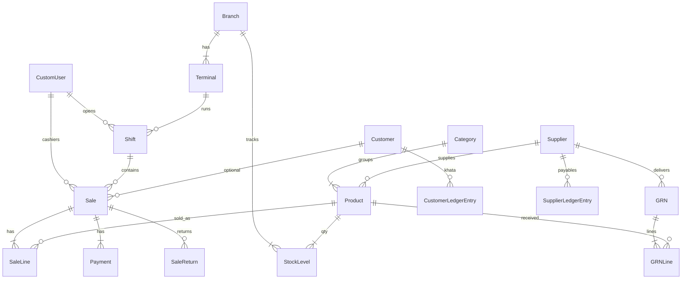

## Tests

```sh
docker compose exec backend python manage.py test
cd frontend && npm run lint && npm run build
```

Browser check of the redesigned pages (till sale, khata via F6, drawer expense, PIN sign-in, returns):

```sh
cd e2e && npm install && BASE=http://localhost:3000 PASSWORD=<seed_demo password> node design.mjs
```
