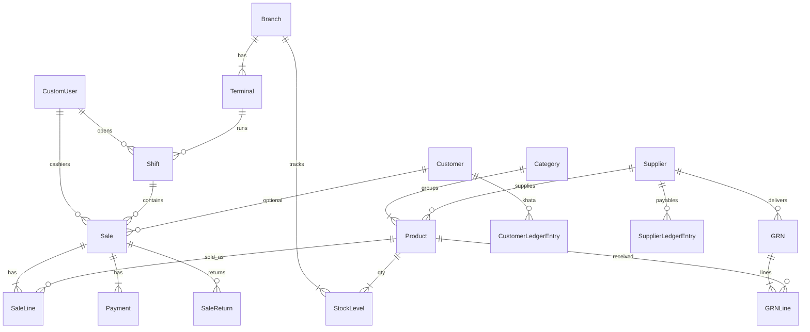

# Tijori POS

Single-shop barcode point of sale for Pakistani retail (Rs). Django + PostgreSQL API, React till UI, English / Urdu.

## Features

- **POS** — barcode scan, cash / JazzCash / Easypaisa / Raast / card / khata (payment method labels only), shifts, receipts, offline sync
- **Inventory** — products, extra barcodes, sale rate, stock, low-stock & expiry alerts
- **Purchases** — GRN post/void, purchase returns
- **Sales** — history, invoice returns, walk-in returns
- **Customers / suppliers** — khata ledgers and payments
- **Staff** — roles & permissions, PIN switch on till
- **Reports / insights** — sales, stock, expenses
- **Backup** — SQL dump from Settings or `infra/scripts/backup.sh`

## Quick start

```sh
cp .env.example .env
cp frontend/.env.example frontend/.env
docker compose up -d --build --wait
```

Open http://localhost:3000 · API http://localhost:8000

**Fresh demo data**

```sh
docker compose exec backend python manage.py seed_demo
```

**Restore an existing dump** (replaces DB data)

```sh
docker compose exec -T db psql -U smartshop -d smartshop -c "DROP SCHEMA public CASCADE; CREATE SCHEMA public; GRANT ALL ON SCHEMA public TO public;"
# PowerShell:  cmd /c "type backups\your-dump.sql | docker compose exec -T db psql -U smartshop -d smartshop -v ON_ERROR_STOP=1"
# bash:        docker compose exec -T db psql -U smartshop -d smartshop -v ON_ERROR_STOP=1 < backups/your-dump.sql
```

### Demo logins (after seed / handoff dump)

| Email | Role |
|---|---|
| `admin@smartshop.local` | Owner + Django admin |
| `owner@smartshop.local` | Full shop access |
| `manager@smartshop.local` | All except staff admin |
| `cashier@smartshop.local` | POS only |
| `stock@smartshop.local` | Products / purchases |
| `accounts@smartshop.local` | Reports / expenses |

Password is printed by `seed_demo`, or whatever you set after restore.

## Shop deploy (short)

1. Set strong `DJANGO_SECRET_KEY` and `POSTGRES_PASSWORD` in `.env` (`DJANGO_DEBUG=False` via prod compose).
2. Add LAN IP to `DJANGO_ALLOWED_HOSTS` and `CORS_ALLOWED_ORIGINS`.
3. `docker compose -f docker-compose.prod.yml up -d --build --wait`
4. `createsuperuser`, then add cashiers under Settings → Staff.

## Database diagram



## Tests

```sh
docker compose exec backend python manage.py test
cd frontend && npm run lint && npm run build
```

Browser check of the redesigned pages (till sale, khata via F6, drawer expense, PIN sign-in, returns):

```sh
cd e2e && npm install && BASE=http://localhost:3000 PASSWORD=<seed_demo password> node design.mjs
```

## Stack

| Layer | Tech |
|---|---|
| Backend | Django 5 + DRF, session auth |
| DB | PostgreSQL 16 |
| Frontend | React + Vite + TypeScript + Tailwind |
| Run | Docker Compose (`:3000` UI, `:8000` API, `:5433` DB) |
